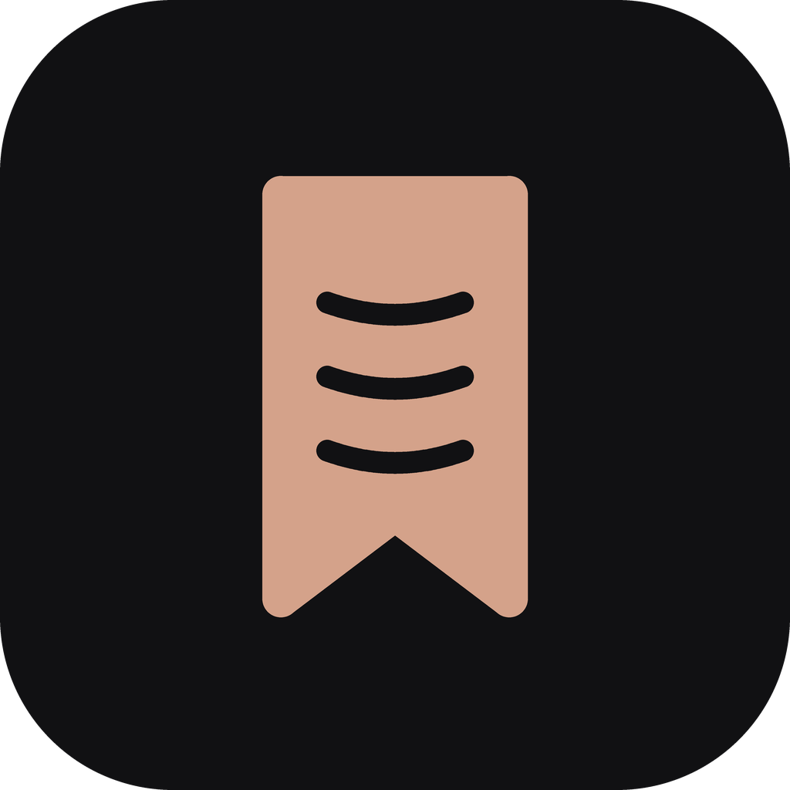
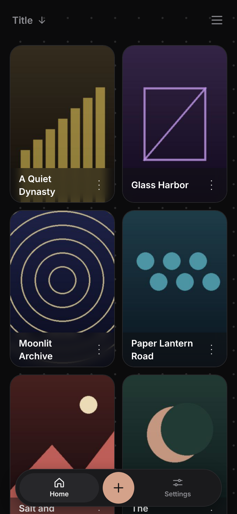
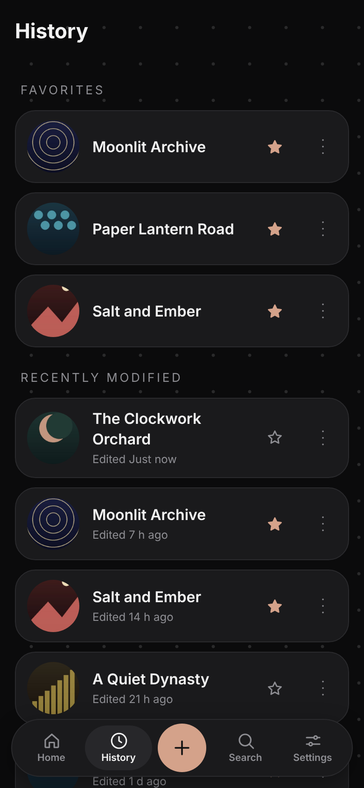
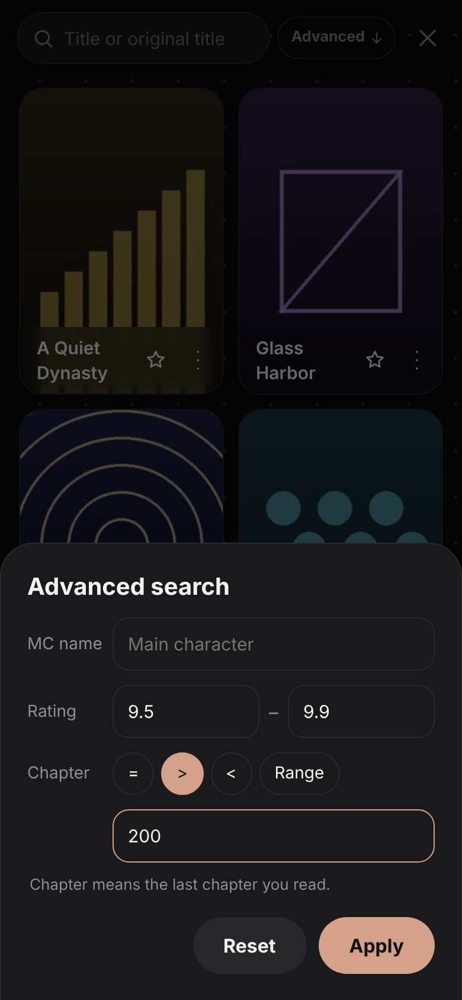
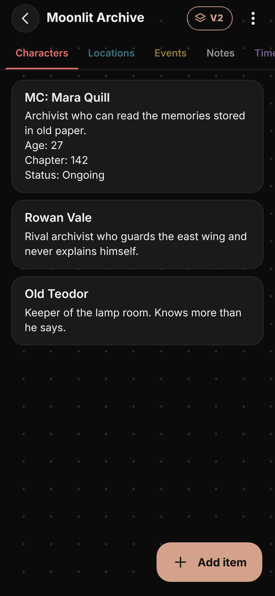

 

# Novel Tracker DB

**A personal space to organize the novels you read and keep track of every detail.**

---

## About

Novel Tracker DB is built for readers who keep their own notes on the novels they follow: characters, events, locations, and anything else worth remembering. Each novel has its own database, organized into categories you name yourself. Everything stays on your device, with no account and no internet requirement.

## Screenshots

<table align="center">
  <tr>
    <td align="center"></td>
    <td align="center"></td>
    <td align="center"></td>
    <td align="center"></td>
  </tr>
  <tr>
    <td align="center"><b>Home</b> Covers, stars, sort, and view switch</td>
    <td align="center"><b>History</b> Favorites and recently modified</td>
    <td align="center"><b>Advanced search</b> MC name, rating, last chapter</td>
    <td align="center"><b>Novel</b> Colored tabs and versions</td>
  </tr>
</table>

Screenshots use sample data.

---

## Features

## Features

| Area | What you can do |
| --- | --- |
| **History** | A page next to the + button with your Favorites at the top and Recently modified below. Both use the same novels as Home, so any edit shows everywhere at once. |
| **Favorites** | Tap the star beside the three dots on any novel. The choice is kept after restarting the app. |
| **Search** | The Search tab opens a compact search bar at the top of Home. Find novels by title or original title. |
| **Advanced search** | Tap Advanced to filter by main character name, a rating range (for example 9.5 to 9.9), and the last chapter you read (equal to, above, below, or within a range). Values come from your existing novel notes. |
| **Automatic backup** | Choose weekly, monthly, or every three months and a folder. The first time you pick a folder, a short options popup lets you include app data and settings and choose the novel format (default app format, `.nov`, or `.txt`). Your choices are remembered and can be changed any time under Automatic backup. A backup is saved when the app opens or returns to the screen and one is due. |
| **Page settings** | Pick which page opens when the app starts: last screen, Home, History, Settings, or one specific novel found by title or original title. |
| **Library** | Add novels with a title, an original title, a template, and a tag. Switch between a big-cover grid and a compact title list. Sort by title, last modification, or date of insertion. The Home list keeps its place when you come back from a novel. |
| **Tags** | Every novel starts as Normal. Create, assign, and delete your own tags. A leading 🔞 in an imported title assigns the Adult tag automatically. |
| **Covers** | Set a cover from your gallery or clear it. The cover fills the card behind a translucent title bar. |
| **Categories** | Create as many as you like and switch with scrollable tabs. A novel always opens on its first category. Pick a color from the presets or open the color wheel to choose any color. Tap the active tab to rename it. |
| **Items** | Open any item on its own page with Title and Synopsis fields that save as you type. Duplicate or delete an item from its menu. Search inside a category. |
| **Versions** | Keep several versions of a novel's data. The V-badge in the header opens them, shows the latest, and lets you switch. The badge number is read from the version name, so "Version 5" always shows V5. Renaming a version renames it in every novel that has it. Tap outside the list to close it. |
| **Arthur Other Works** | In categories named Arthur Other Work or Arthur Other Works, each item that matches another novel in your library gets a View Original Novel button. The novel you are already viewing never gets one. |
| **Templates** | Save a novel's structure as a template and pick it when adding a new novel. |
| **Information** | See statistics for each novel: categories, items, characters, tag, versions, and more. |
| **Export** | Back up all novels or only the ones you pick, as a zip, in Novel Tracker DB, `.nov`, or `.txt` format. App settings can be included. |
| **Import** | Import `.nov`, `.txt`, Novel Tracker DB files, or a zip of them. Send novels to the homepage or add them as a version of matching novels. |
| **Theme** | Dark, Light, or AMOLED black. |
| **Design style** | A background of None, Dots, Star, Grid, or your own photo, with opacity and size controls (and darkness for photos). |

## Installation

### Android

1. Open the [GitHub Releases page](https://github.com/axon469/Novel-Tracker/releases).
2. Open the latest release.
3. Download the APK file.
4. Install it on your Android device.

Android may ask you to allow installation from your browser or file manager. Only install APKs from a source you trust.

### Demo Website

1. Visit the [Novel Tracker DB website](axon469.github.io/Novel-Tracker/).
2. Open it in a modern browser.
3. Start tracking your novel.

## Version history

| Version | Notes |
| --- | --- |
| **1.1.8** | Permanent novel and version IDs with safe migration, version add and delete, reliable related-works matching for every category name and version, saved related-work links, IDs preserved in backups. |
| **1.1.6** | Android folder picker and backup options for automatic backups, version badge read from the version name, startup page setting, steadier import countdown. |
| **1.1.4** | History and Favorites, Search with Advanced search, automatic backups, novels open on their first category. |
| **1.1.0** | On-device database for large libraries, lazy loading, skeleton placeholders, color wheel. |
| **1.0.9** | Scroll position restored, version list, duplicate and delete items, Android polish. |
| **1.0.7** | Tags, sort and view switch, version selector, zip import, new Design style page. |
| **1.0.0** | First release. |

---

Novel Tracker DB · Version 1.1.8 · Made by Abu Bokker (axon469)

